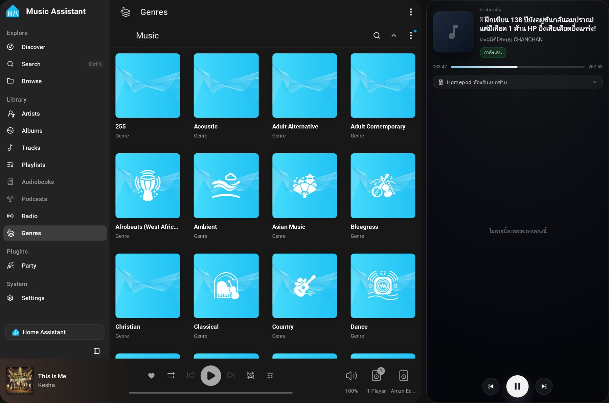
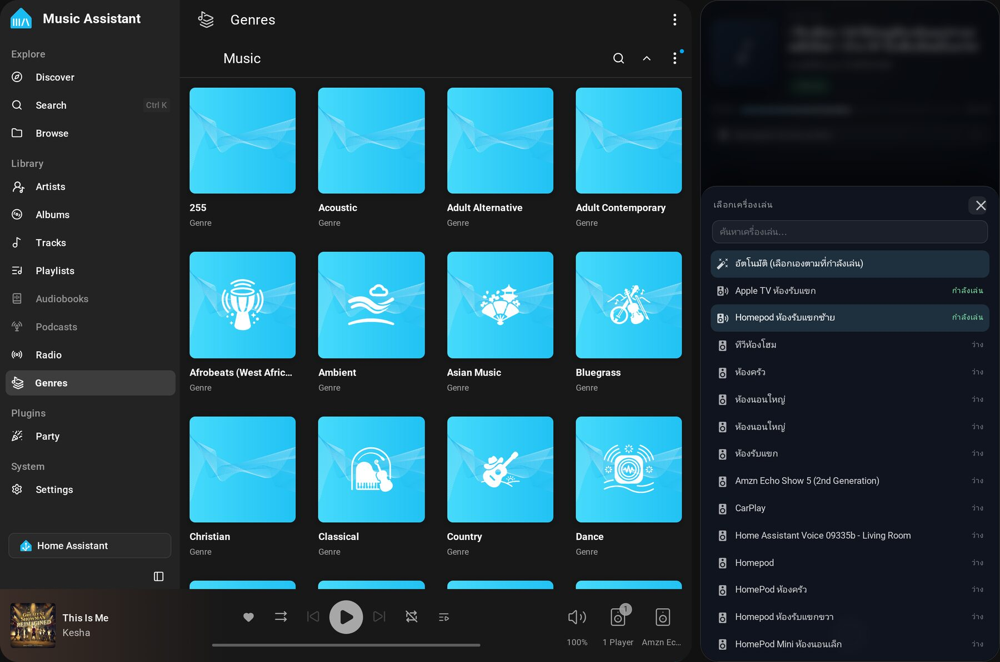
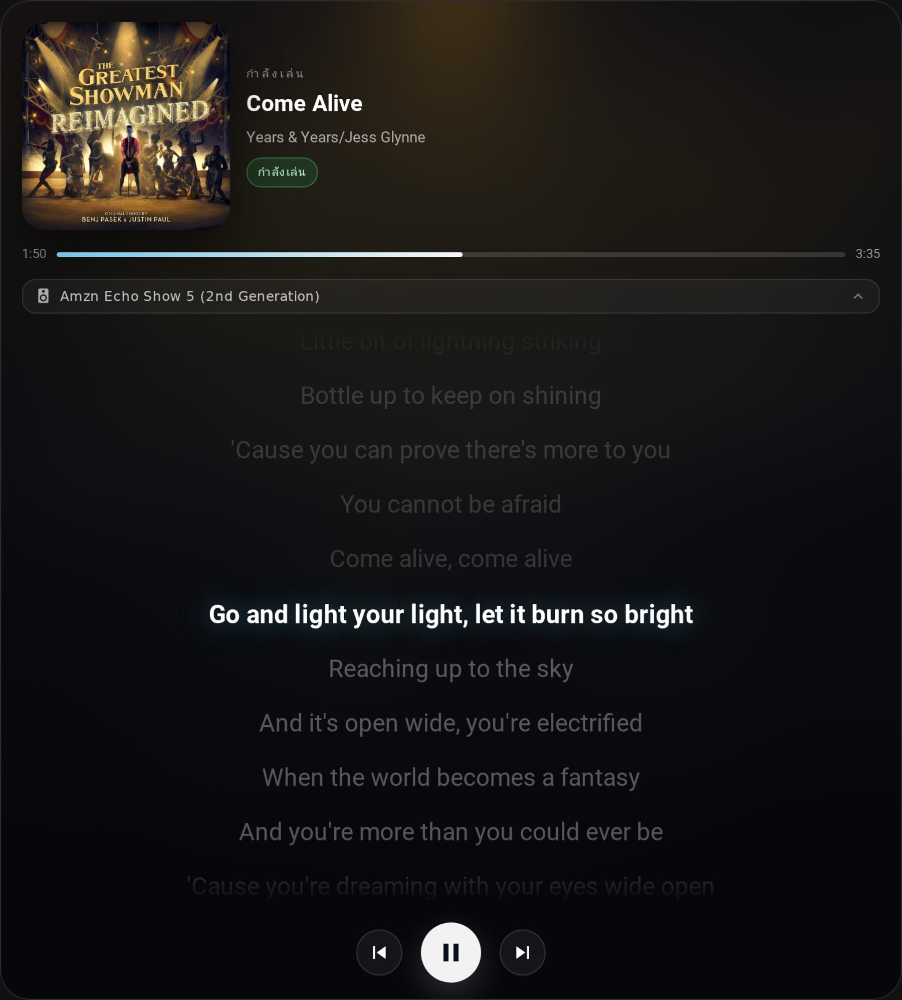
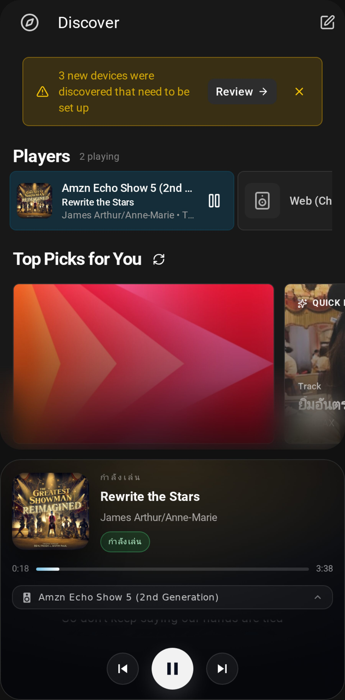

# Music Station

**Perfect Smart Thing** · Home Assistant Lovelace card

การ์ดเดียวที่รวม **Music Assistant** และ **คาราโอเกะ (เนื้อเพลงวิ่งตามจังหวะ)** ไว้ด้วยกัน
A single Home Assistant card that puts the Music Assistant web UI and a karaoke-style "now playing" panel side by side.



| Player picker | Karaoke panel | Mobile layout |
|---|---|---|
|  |  |  |

## Features

- 🎵 **Music Assistant pane** — ฝัง UI ของ add-on ผ่าน Supervisor ingress (หา add-on เองอัตโนมัติ, ต่อ session ใหม่ให้ทุก 60 วินาที)
- 🎤 **Karaoke panel** — ปกอัลบั้ม + แถบเวลา + ปุ่มควบคุม + **เนื้อเพลงซิงก์** จาก [LRCLIB](https://lrclib.net)
- 🎯 **Player picker** — เลือกเครื่องเล่นจาก UI (ค้นหาได้) และจำค่าที่เลือกไว้ต่อ dashboard
- 🧹 **Now-playing เดียว** — ซ่อนแถบ now-playing ของ Music Assistant ให้อัตโนมัติ (`hide_ma_player_bar`, ปิดได้)
- 🔁 **Auto fallback** — ถ้าเครื่องที่เลือกไม่มีเนื้อเพลง (เช่นกำลังเล่น YouTube) จะสลับไปเครื่องที่กำลังเล่นเพลงให้
- 🖼️ **Artwork ผ่าน HA media proxy** — ไม่ติดปัญหา mixed content จาก URL `http://<lan-ip>:8095`
- 🌏 ไทย / อังกฤษ, **ไม่ต้องมี dependency ภายนอก**, ทำงานออฟไลน์ได้ (ยกเว้นการดึงเนื้อเพลงครั้งแรก)
- 📱 รองรับทั้งแท็บเล็ต (เคียงข้าง) และมือถือ (ซ้อนแนวตั้ง)

---

## ติดตั้ง / Installation

### ทางที่ 1: HACS (แนะนำ)

1. HACS → ⋮ → **Custom repositories**
2. เพิ่ม `https://github.com/PerfectSmartThing/ha-music-station` โดยเลือกหมวด **Dashboard**
3. ติดตั้ง **Music Station** → รีสตาร์ท/รีเฟรช Home Assistant
4. เพิ่ม resource อัตโนมัติโดย HACS (ถ้าไม่ขึ้น ให้เพิ่มเองตามข้อ 2 ของทางที่ 2)

### ทางที่ 2: Manual (3 นาที)

1. คัดลอก `music-station.js` ไปไว้ที่:

```
/config/www/nabu/music-station.js
```

2. `Settings → Dashboards → ⋮ → Resources → Add resource` ชนิด **JavaScript module**

```
/local/nabu/music-station.js
```

3. วางการ์ด:

```yaml
type: custom:music-station
```

ไฟล์เดียวจบ — การ์ดคาราโอเกะถูกรวมมาในไฟล์นี้แล้ว (โฟลเดอร์ `dist/` มีแยกให้ถ้าต้องการใช้งานเดี่ยว)

---

## ตัวเลือก / Options

| Key | ค่าเริ่มต้น | คำอธิบาย |
|---|---|---|
| `addon` | *auto* | slug ของ Music Assistant add-on (ปกติไม่ต้องใส่) |
| `entities` | — | รายชื่อ `media_player.*` เรียงตามความสำคัญ (ตัวแรกที่กำลังเล่นจะถูกเลือก) |
| `entity` | — | ระบุเครื่องเล่นตายตัวแทน `entities` |
| `layout` | `side` | `side` = สองคอลัมน์, `stack` = ซ้อนแนวตั้ง |
| `side` | `38` | ความกว้างคอลัมน์เนื้อเพลง (%) เมื่อ `layout: side` |
| `karaoke_height` | `260` | ความสูงของแถบคาราโอเกะ (px) เมื่อ `layout: stack` |
| `height` | — | กำหนดความสูงของการ์ดเอง เช่น `calc(100dvh - 200px)` |
| `language` | `th` | `th` หรือ `en` |
| `show_transport` | `true` | ปุ่มก่อนหน้า / เล่น–หยุด / ถัดไป |
| `show_player_picker` | `true` | แถบเลือกเครื่องเล่น |
| `show_volume` | `true` | แถวสไลเดอร์เสียง + ปุ่ม mute |
| `compact` | `false` | โหมดกะทัดรัด: ซ่อนปก/ชื่อเพลง (เหมาะกับ layout มือถือ) |
| `prefer_lyrics` | `true` | สลับไปเครื่องที่มีเนื้อเพลงอัตโนมัติ |
| `hide_music_assistant` | `false` | แสดงเฉพาะคาราโอเกะ (ใช้ได้บน HA ที่ไม่ใช่ HAOS) |
| `hide_ma_player_bar` | `true` | ซ่อนแถบ now-playing ของ Music Assistant (เหลือ now-playing เดียวคือของเรา) |
| `hide_ma_bottom_nav` | `false` | ซ่อนแถบเมนูล่างของ Music Assistant (ใช้กับ layout มือถือ) |

### ตัวอย่าง: แท็บเล็ต

```yaml
type: custom:music-station
entities:
  - media_player.living_room
  - media_player.kitchen
side: 38
language: th
```

### ตัวอย่าง: มือถือ (ซ้อนแนวตั้ง + ซ่อนปุ่มควบคุม เพราะมีในแผง MA แล้ว)

```yaml
type: custom:music-station
layout: stack
karaoke_height: 270
height: calc(100dvh - 200px)
show_transport: false
entities:
  - media_player.living_room
```

### ตัวอย่าง: คาราโอเกะอย่างเดียว

```yaml
type: custom:music-station
hide_music_assistant: true
entities: [media_player.living_room]
```

หรือใช้การ์ดย่อยโดยตรง (ต้องโหลด `dist/karaoke-now-playing.js` เพิ่ม):

```yaml
type: custom:karaoke-now-playing
entities: [media_player.living_room, media_player.kitchen]
```

---

## ความต้องการ / Requirements

- Home Assistant **2024.6** ขึ้นไป
- **Home Assistant OS / Supervised** สำหรับแผง Music Assistant (ใช้ Supervisor ingress)
  - HA Container/Core: ใส่ `hide_music_assistant: true` เพื่อใช้เฉพาะคาราโอเกะ
- Music Assistant integration (เพื่อให้มี `media_player.*` และปกอัลบั้ม)
- อินเทอร์เน็ตสำหรับดึงเนื้อเพลงครั้งแรก (แคชไว้ในเบราว์เซอร์)

## หมายเหตุ / Notes

- เนื้อเพลงมาจาก LRCLIB แบบสาธารณะ — เพลงที่ไม่มีในฐานข้อมูลจะขึ้น “ไม่พบเนื้อเพลงของเพลงนี้”
- ถ้าเพลงเริ่มเล่นช้า ให้ตรวจที่ผู้ให้บริการเพลง (Apple Music / YouTube Music) ใน Music Assistant —
  การ์ดนี้เป็นเพียงส่วนแสดงผล
- ใบอนุญาต MIT — นำไปใช้/แก้ไข/แจกจ่ายได้

## License

MIT © 2026 Perfect Smart Thing
